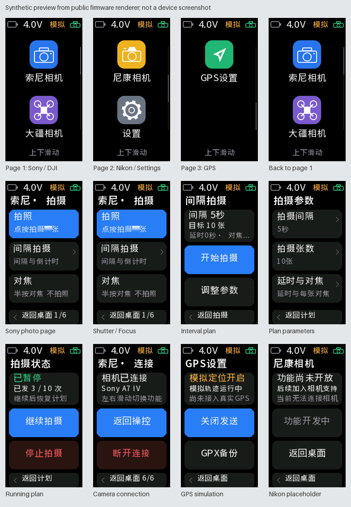
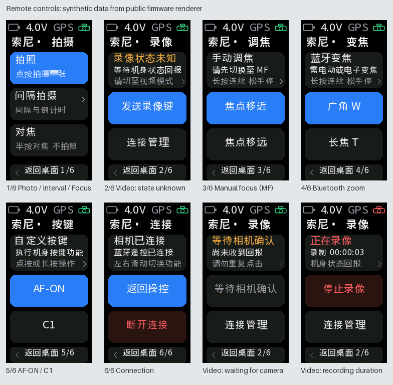
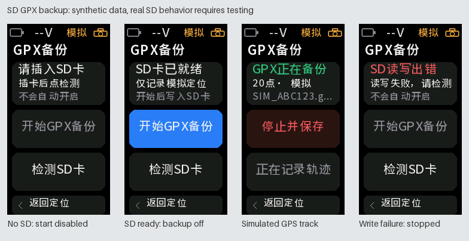

# ESP32 Camera Companion / ESP32 相机伴侣

为 **Waveshare ESP32-C6-Touch-LCD-1.47（172 × 320）** 制作的独立 Arduino 相机遥控器，当前版本 **0.3.0**。

支持 Sony BLE 拍照/对焦、间隔拍摄、录像与机身状态、录制计时、AF-ON/C1、蓝牙调焦/变焦，以及模拟 GPS 和 SD 卡 GPX 备份。黑色圆角触摸界面，索尼相机、大疆相机、尼康相机、设置和 GPS 设置为平级入口。大疆和尼康入口目前仅为待开发提示。



图片使用虚构数据，由公开版的实际绘图代码生成，不能代替真实 LCD 或相机验证。

## 当前验证范围

| 项目 | 状态 |
| --- | --- |
| ESP32-C6 触摸板连接 Sony A7 IV / ILCE-7M4、相机固件 1.01 | 0.2.2 开发版已有成功连接和控制的使用反馈；用户对当前版本表示满意，未提供新增功能逐项实测结果 |
| 本公开副本的编译、主机检查 | 见 [验证记录](docs/verification.json) |
| 公开版 Noto 字形的实际屏幕效果 | 尚未上板复验；除字形数据和许可头外，20个固件文件中的另外19个与当前0.3.0开发版逐字节一致 |
| 新录像/按键/调焦/变焦、动画实际帧率、真实 SD/GPX 和文件落盘 | 已实现，仍需按 [实物清单](docs/HARDWARE_TESTS.md) 逐项验证 |
| 间隔拍摄长测、GPS/EXIF、关开机重连耗时 | 仍需分别实测 |

此处“控制成功”不代表所有命令、所有相机或全部相机固件均已验证。原开发版采用的本机字体没有包含在本仓库，公开版使用 SIL OFL 1.1 字形。

## Arduino IDE 编译和上传

1. 安装 **esp32 by Espressif Systems 3.3.12** 和 **GFX Library for Arduino 1.6.9**。
2. 打开 [CameraCompanion/CameraCompanion.ino](CameraCompanion/CameraCompanion.ino)。不要把主 `.ino` 单独移出同名草图目录。
3. 使用以下配置，然后在 Arduino IDE 验证、选择自己的设备端口并上传：

| 选项 | 值 |
| --- | --- |
| Board | ESP32C6 Dev Module |
| USB CDC On Boot | Enabled |
| Flash Size | 8MB |
| Partition Scheme | 8M with spiffs（`default_8MB`） |
| 串口监视器 | 115200，命令以新行结束 |

本项目使用此核心自带的 **NimBLE C API** 和 SD/FS 库，不需要安装 NimBLE-Arduino、LVGL 或独立触摸库。其他核心版本尚未兼容验证。上传时不要开启整片擦除，以保留已有设备配置。

显示和触摸使用本板特定引脚、JD9853 初始化与 34 列偏移；不能直接作为其他 ESP32/S3 板的通用固件。硬件说明见 [HARDWARE.md](docs/HARDWARE.md)。

## 连接相机

1. 初次测试时先断开手机 App 对相机的连接，必要时暂关手机蓝牙，避免自动抢连。
2. 相机开启蓝牙和「Bluetooth Rmt Ctrl / 蓝牙遥控」，进入配对状态。
3. 点击「索尼相机」，在拍摄页点连接入口，或左滑至第6页「连接管理」，点「扫描相机」，选择相机后连接。
4. 按机身提示确认；若板上出现六位数字比较，请核对双方后点「一致，配对」。若要求在相机输入 PIN，则输入板上显示的码。并非每次配对都出现六位数字。
5. 显示已连接后先测试对焦/单拍，再逐项验证间隔拍摄和定位。具体结果应以相机动作和保存文件为准。

本版按 camera-gps-link 模式 1 的主要顺序实现：先请求 MTU 517，再建立安全连接，成功后等待 500ms 再发现服务；实际 MTU 由双方协商。配对码需要明确用户确认，不自动同意，不输出到串口、不保存到配置。

只保存一台相机。已保存相机可在板子重启或连接丢失后自动重连；前 60 秒使用较密集扫描，之后降低占空比。具体速度尚未测量，连续失败有次数限制。断线停止拍摄，重连不会补拍或自动恢复计划。

## 拍摄、桌面和手势

- 索尼入口直达第1页「拍照 / 间隔拍摄 / 对焦」；第2页录像，其后依次为手动调焦、蓝牙变焦、AF-ON/C1、连接管理。左右滑动只切当前应用功能，首尾停住，底部显示页码并返回桌面。
- 间隔默认 5 秒、10 张，可设置启动延时、每张对焦、具体张数或持续拍摄；支持暂停/继续/停止。
- 桌面上下每次翻两个图标，末页只有 GPS；详情页点底部或右滑逐级返回。翻页有短缓动，边缘轻回弹，顶部状态栏固定。慢帧会提前结束过渡，实物流畅度需验证。
- 普通按钮松手才执行，从按钮开始滑动不会触发拍照。AF-ON/C1、调焦/变焦支持点按及静止350ms后的长按，松手/滑出/离页请求释放，单次保持最多10秒。
- 返回桌面不停止后台照片计划、录像、GPS或GPX；照片计划和录像在桌面提供状态入口。BOOT停止照片计划并释放遥控按键，**不会停止录像或GPX**；录像用录像页/机身停止，GPX用「停止并保存」。RESET会重启。
- 正在拍摄时断开会先确认；「设置 → 索尼连接选项 → 配对管理」可以忘记当前相机，不清空其他 NVS 数据。
- 状态栏显示电池电压、GPS/模拟及相机连接图标；相机回报正在录制才显示红色。电压未校准，不代表电量百分比或充电状态。

## 录像、AF-ON/C1、调焦和变焦

录像状态来自相机 FF02 通知，不把写入 ACK 当作录制成功。初连未获状态时显示未知；「发送录像键」模拟一次 REC 切换，可能开始也可能停止。机身手动录像也可通过通知同步。等待确认期间禁止重复点击，超时显示未知且不自动重试。

录像页只在录制中显示「录制 时:分:秒」，停止、未知或断开后隐藏。计时从本次首次收到录像中通知起算，重复通知、切页不重置；连接前已录制的时长无法由当前通知恢复。它不是从视频文件读取的总时长。

AF-ON/C1执行机身为按键分配的功能；调焦要求MF和支持电子驱动的镜头；变焦要求电动变焦镜头或可用且已启用的机身电子变焦。纯机械调焦/变焦环不能由这些命令驱动。照片计划与新遥控互斥，暂停计划也需先停止。更多步骤见 [遥控说明](docs/REMOTE_CONTROLS.md)。



## GPS：当前仅为明确的模拟数据

默认不发送定位，需在「GPS设置」主动开启。轨迹是以 `22.540000, 114.050000` 为起点的虚构测试路线，半径约 100m、速度约 1m/s；不代表任何用户的真实位置。

每秒生成样本，通信空闲时约每 5 秒发送，拍摄优先。UTC 为固定测试起点加运行时间、时区 +480 分钟；重启会重置测试时钟。不发送 CC13 自动设置相机时钟。开启模拟定位拍摄的照片可能包含这些测试坐标和时间，请勿当作真实定位记录。

「模拟失去信号」停止新定位写入，但相机可能缓存上次位置。当前没有接入 GNSS 模块或 NMEA 解析；未来还需实现有效性、新鲜度和断信号处理。GPS/EXIF 尚待实物验证。

## SD 卡 GPX 备份

插卡后进入「GPS设置 → GPX备份 → 检测SD卡」，检测成功才可开始。备份默认关闭，开始前重新检查卡；不格式化、不删除、不覆盖旧轨迹。当前只记录显式开启的模拟定位，约1Hz，未开启或无有效样本时等待，不续写过期点。

文件位于卡上 `/CameraCompanion/GPX/SIM_XXXXXX.gpx`，名称及元数据明确标记模拟坐标和测试UTC；停止并保存后再拔卡。读写错误会停录，重新插卡需手动开始。SD和LCD共用SPI互斥锁，文件写入由独立任务处理；突然断电/写入中拔卡仍可能损坏文件。步骤与限制见 [GPX说明](docs/GPX.md)。



## USB 命令与诊断

串口输入 `help` 查看命令，输入 `status` 查看异步结果。常用命令：

```text
scan
connect 1
saved
disconnect
shoot
focus
interval 5
count 10
delay 0
af 0
start
pause
resume
stop
sim 1
sim 0
record
afon
c1
near
far
wide
tele
```

以上命令分别按需发送，不要整组粘贴执行。`record`是一次REC切换，其余新遥控命令是一次有界短按。间隔单位为秒，`count 0` 表示持续拍摄。`profile 0|1|2` 选择自动/旧/新定位协议，需断开后修改。`forget YES` 只忘记本工程保存的相机。GPX从板上页面启停，`status`可查看记录状态及最近`frame_ms`，该值含调度等待，不能直接当持续FPS。

连接失败时先保留全部 `status`，包括版本、MTU、阶段、`security_code`、`smp_reason`、`disconnect_reason` 和事件序列。`smp_reason=-1` 表示没有收到该事件。报告问题前删去设备名称等个人标识，不提交密钥、设备存储转储或原始配置。更多技术说明见 [PROTOCOL.md](docs/PROTOCOL.md)。

## 开发、许可和发布

- [主机检查和资源生成](tests/README.md)：不需要真实相机，不能代替实物验证。
- [版本变更](CHANGELOG.md)：0.3.0新增内容与验证边界。
- [字体来源](docs/FONT.md)：预生成字形已包含，常规 Arduino 编译不需要原始 TTF 或 Python。
- [第三方来源和声明](THIRD_PARTY_NOTICES.md)：保留上游公开署名及许可证。
- [隐私与公开包检查](docs/PRIVACY.md)：源码清单、哈希及扫描方法。
- 原创代码按 [MIT](LICENSE) 发布；字体及第三方部分遵循各自许可证。相机品牌名称只用于标识兼容对象，不表示官方产品或背书。

本仓库不包含个人配置、BLE 配对密钥、真实相机标识、原始调试日志、预编译固件、工具链或本地开发环境路径。
